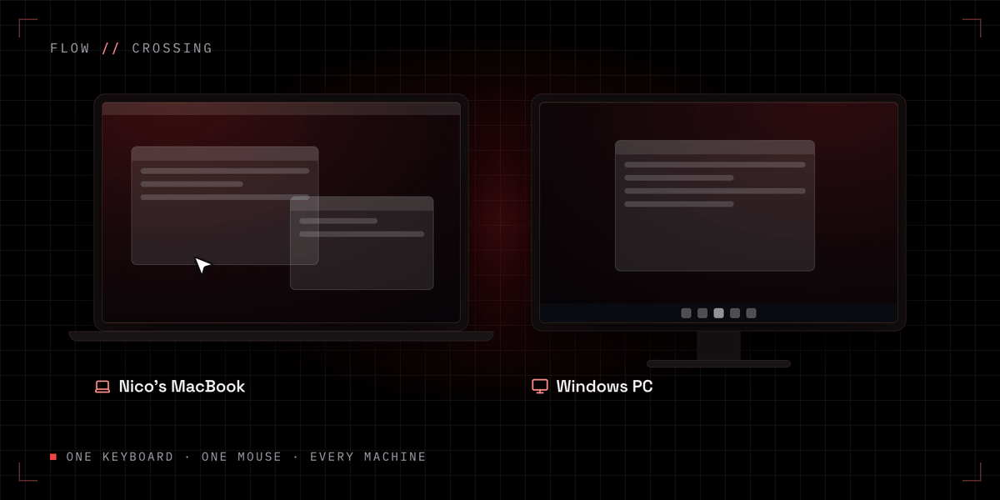
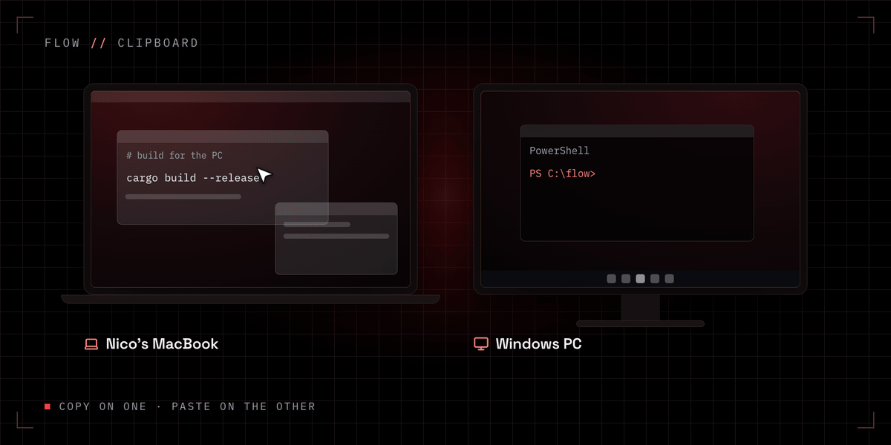
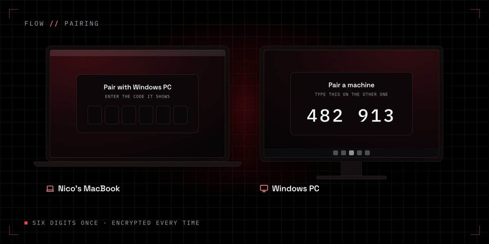
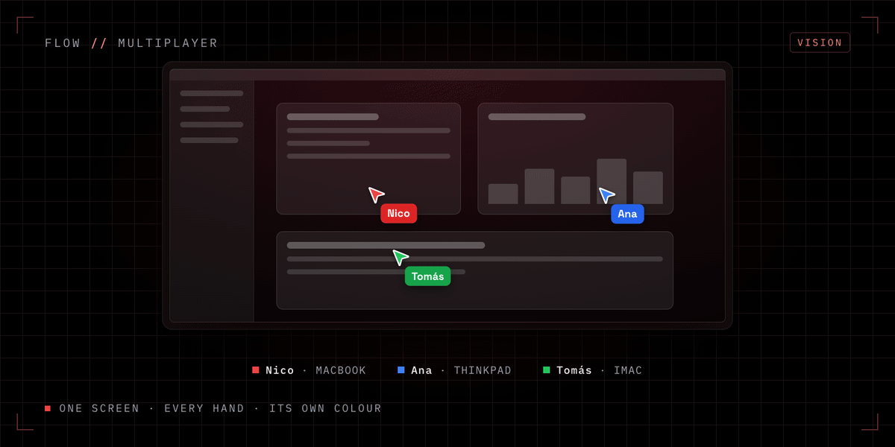

<p align="center">
  
</p>

<p align="center">
  <a href="README.es.md"><b>Leer en español</b></a> &nbsp;·&nbsp;
  <a href="#-07-built-on-beamer"><b>Built on Beamer</b></a> &nbsp;·&nbsp;
  <a href="WIRE.md"><b>Wire protocol</b></a> &nbsp;·&nbsp;
  <a href="SECURITY.md"><b>Security</b></a>
</p>

FLOW turns the computers on your desk into one workspace. Push the pointer off the edge of your Mac and it carries on onto the PC beside it, keyboard, shortcuts and clipboard included. Machines talk to each other directly over your network, encrypted, with no account and no server in between.

FLOW started as my own Rust prototype for sharing a clipboard between PCs. The hard part, capturing input at the operating system level and handing it across safely, was never going to be quick to get right. [Beamer](https://github.com/kalkman-code/beamer) by Toby Kalkman had already done it, carefully and in the open. So FLOW is now a fork of Beamer: everything Beamer does, plus the idea FLOW was born with. **Several people, several machines, one desk, and every hand in its own colour.**

<p align="center">
  
</p>

### `// 01` What you get

| | |
|---|---|
| **Push through the edge** | The pointer leaves through the edge that faces the other machine and arrives at the same point along the border. The edge resists, lights up as you push, and gives. |
| **Or press a key** | Double-tap or hold a trigger key to switch without moving the pointer. Shake the mouse to come home. |
| **Either way round** | The Mac drives the PC, the PC drives the Mac. Macs drive Macs, PCs drive PCs. One switch per direction. |
| **The clipboard comes with you** | Text and images, both ways, at the moment you cross. |
| **Your shortcuts still work** | Between a Mac and Windows, Cmd becomes Ctrl and Option becomes Alt, so Cmd+C copies on the PC too. |
| **Media keys and gestures** | Play, pause and volume cross. Three and four finger swipes on the Mac's trackpad drive Task View and virtual desktops on Windows. |
| **Several machines** | Pair each machine with the others and arrange them on a map: edges, parts of an edge, corners, even the MacBook's notch. |
| **Encrypted and direct** | Pair once with a six-digit code. Every link after that is end to end encrypted, with fresh keys each time. |
| **The visitor badge** *(new in FLOW)* | While another machine drives yours, a tag in that machine's colour follows the pointer and says whose hand it is. |

Mac (macOS 13 or later), Windows 10 and 11, and Linux as a Flatpak (tested on GNOME under Wayland; KDE and X11 still experimental). Free and open source under GPL-3.0.

### `// 02` Push through the edge

This is the part that makes it feel right, and it comes straight from Beamer. Touching the edge does nothing on its own. Pushing past it builds pressure, which drains away when you stop, so the pointer never jumps to the other screen by accident on its way to a scroll bar. Keep pushing and the edge gives: the pointer lands on the other machine at the same height, with a short arrival so you never hunt for it.

- **Pick the stretch.** A whole edge, only part of it, a corner, or up through the notch.
- **Pick how hard.** Resistance is a setting, from a light touch to a deliberate shove.
- **Pick the look.** Glow, Beam and Aperture, or the full effects (Membrane, Sparks, Instrument, Folio, Selvedge) with colour packs, size, length and frame rate.
- **It stays out of the way.** A drag that reaches the edge stays a drag, and a full-screen app can hold its edges.

The model is pure and tested on its own: [`core/return_edge.py`](core/return_edge.py).

### `// 03` Clipboard and pairing

<table>
  <tr>
    <td width="50%"></td>
    <td width="50%"></td>
  </tr>
  <tr>
    <td><b>Copy on one, paste on the other.</b> The clipboard travels with the pointer when you cross, not before and not to everyone: only the machine you are on gets it.</td>
    <td><b>Six digits once, encrypted every time.</b> One machine shows a code for a minute, the other types it. The code never travels; both sides prove they know it (CPace).</td>
  </tr>
</table>

### `// 04` Multiplayer: the vision

<p align="center">
  
</p>

A KVM moves one person's input between machines. FLOW wants the other thing too: several people at their own machines, all visible on the screen that matters right now, each pointer in its owner's colour with their name beside it. Point at a line on a colleague's screen without taking their mouse away. Walk someone through a setting while they keep control.

An operating system has one real pointer, and Beamer's rule that a machine obeys one owner at a time is what keeps input safe. So FLOW builds multiplayer in layers, never by fighting that rule:

| Step | What it does | Status |
|---|---|---|
| **Visitor badge** | While another machine drives yours, the real pointer carries a tag with that machine's name and colour. Same colour on every machine, derived from its id, so nothing new goes on the wire. | Built for Mac and Windows, waiting for hardware testing |
| **Your colour** | Choose the colour your machine shows on others, shared with the rest of the settings. | Next |
| **Ghost pointers** | Press a key and your mouse drives a pointer of your colour on another screen, while its owner keeps their own pointer. It points; it never clicks. | Designed: a new message type, ignored by stock Beamer |
| **Presence** | See who is linked, who is driving what, and where everyone's pointer is, at a glance. | Idea |
| **Files** | Send a file to the machine you are on, over the same encrypted link. | Idea, from FLOW's first prototype |

New messages ride the same encrypted link and are announced as capabilities, and the wire protocol says a peer ignores message types it does not know. So a FLOW machine can keep pairing and crossing with stock Beamer 1.5.x while it learns new tricks.

### `// 05` How it works

| Piece | How | Where |
|---|---|---|
| **Capture** | A Quartz event tap on the Mac. Low-level hooks plus Raw Input on Windows, so a push still measures at the very edge. libei and the InputCapture portal on Wayland. Injected events are marked so they never come back around. | [`mac_app/bridge.py`](mac_app/bridge.py), [`win_app/capture_win.py`](win_app/capture_win.py) |
| **Crossing** | Screens, zones and the pressure model, the same on every platform, as pure functions of the pointer, the deltas and a clock. | [`core/return_edge.py`](core/return_edge.py), [`core/ways.py`](core/ways.py) |
| **Ownership** | One owner per machine at a time, a route number so a late request can never move input that has already moved, and every held key released when ownership ends. | [`core/owner.py`](core/owner.py), [WIRE.md §4–5](WIRE.md) |
| **The link** | TCP between peers. X25519 per link, HKDF-SHA-256 over the pairing token, ChaCha20-Poly1305 frames with strict counters, one key per direction. Forward secret, no server. | [`core/protocol.py`](core/protocol.py), [WIRE.md §2](WIRE.md) |
| **Pairing** | CPace (X25519, SHA-512) with a six-digit code shown on one machine and typed on the other; it gives each pair of machines its own token. | [`core/pairing.py`](core/pairing.py), [PAIRING.md](PAIRING.md) |
| **Safety** | If a link drops or an acknowledgement is late, input comes home on its own. A hook never blocks. | [`core/link.py`](core/link.py) |
| **Visitor badge** | Who owns this machine, turned into a tag that follows the pointer. | [`core/visitor.py`](core/visitor.py), [`mac_app/visitor_badge.py`](mac_app/visitor_badge.py), [`win_app/visitor_badge_win.py`](win_app/visitor_badge_win.py) |

The protocol is written down well enough to build a second implementation: [WIRE.md](WIRE.md), [PAIRING.md](PAIRING.md) and [SECURITY.md](SECURITY.md).

### `// 06` Build from source

FLOW has no releases of its own yet, and the app still installs under Beamer's name while the rename is under way. Both builds need Python 3.

**Mac.** Double-click `mac_app/Install-Beamer-Mac.command`. It builds a self-contained app and installs it in `/Applications`. Open it and grant Accessibility and Input Monitoring on the Permissions page, then relaunch from the same page.

**Windows.** From an admin PowerShell:

```powershell
win_app\Install-Beamer.ps1
```

It installs the app, a Start menu shortcut and the two firewall rules.

**Tests.** About 3,300 on the Mac side and 3,400 on the Windows side, with the shared `core/` suite running inside each.

```sh
cd mac_app && .venv/bin/python3 -m unittest discover -s tests -t ..
```

```powershell
cd win_app; python -m unittest discover -s tests
```

Everything about installing, Linux, settings, known limits and troubleshooting is in Beamer's own guide, kept whole in [docs/BEAMER.md](docs/BEAMER.md).

### `// 07` Built on Beamer

FLOW is a fork of **[Beamer](https://github.com/kalkman-code/beamer)** 1.5.8, written and maintained by **Toby George Read Kalkman** ([Kalkman Code](https://kalkmancode.co.uk/beamer)). Beamer is free software under GPL-3.0, and almost everything in this repository is his work: input capture on three platforms, the crossing engine and its effects, pairing, the encrypted link, the settings apps and the documentation.

What FLOW adds or changes is listed in the history of this repository, starting after the commit `Beamer 1.5.8`. If you only need a great software KVM, use Beamer: it has signed releases for Mac, Windows and Linux. Bug reports about anything Beamer does belong upstream, and the plan is for FLOW to keep following Beamer's releases.

Earlier FLOW, the Rust prototype with mDNS discovery and file transfer, lives on at [4mser/flow-legacy](https://github.com/4mser/flow-legacy).

### `// 08` License

GPL-3.0-only, like Beamer. See [LICENSE](LICENSE). Copyright for Beamer stays with Toby Kalkman; FLOW's changes are © 2026 Nicolás Moreno, under the same license.

The animations in this README are illustrations rendered frame by frame from HTML, not screen recordings. Icons in them are from [Lucide](https://lucide.dev) (ISC); type is Space Grotesk and IBM Plex Mono (SIL OFL 1.1).

<p align="center">
  
</p>
